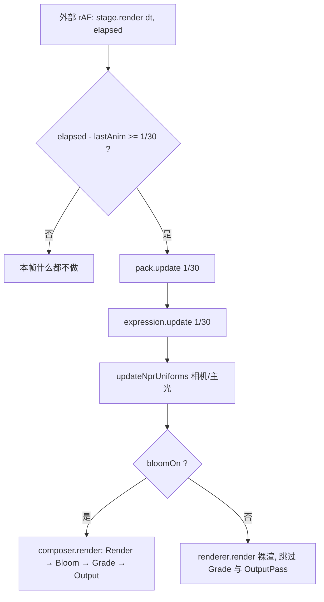
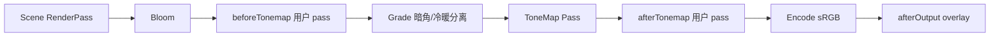

# 渲染管线：着色器扩展与钩子设计

**领域**：WebGL / three.js r186 实时渲染管线
**要解决的问题**：nijimi 现在只能「改引擎源码」来加着色效果，内容侧没有任何扩展点；同时管线本身有若干处会让扩展直接撞墙的结构问题。
**本阶段目标**：先把现状说清楚，再给一套**不改动 FROZEN 契约**的扩展层设计与钩子清单，最后按商业引擎的对照指出哪些地方不科学、为什么。

> 行号基于 2026-10-17 工作树。代码事实标注为 [实测]，与 three 内部行为的对照标注为 [查证]，设计取舍标注为 [判断]。

---

## 0. 结论

1. **着色器支持是「一条硬编码的注入链 + 一个手写材质 + 一个后处理 pass」**，没有注册表、没有变体、没有内容侧 API。三处着色器代码各自为政（`npr.ts` 注入、`kits/conduits.ts` 手写、`npr.ts` 的 grade pass）。
2. **最挡路的不是「缺 shader API」，是 `stage.ts` 的帧循环**：整个 `composer.render()` 被 30fps 动画闸门包住，`dt` 被 `void` 掉。任何靠时间的着色动画（热浪、流光、溶解）都会被锁在 30fps，而相机交互也跟着掉到 30fps。[实测 stage.ts:324-336]
3. **后处理的开关语义是错的**：`setBloom(false)` 直接绕过整条链，调色和 `OutputPass` 一起消失；`setNpr(false)` 顺手关掉调色 pass。这不是「参数」，是三条不同的色彩管线。[实测 stage.ts:333-334, 341-345]
4. **`customProgramCacheKey` 用了随机串**（`npr:abc123`），等于给每个材质单独编译一个 program。材质一多，首帧编译抖动和显存都会线性上涨。[实测 npr.ts:256, 275]
5. **透明通路断了**：grade pass 硬写 `alpha = 1.0`，而 `renderer` 是 `alpha: true`。桌宠悬浮窗这个产品形态，目前**无法**经过后处理链。[实测 npr.ts:951；editors/scene.ts:12 的注释也承认了]
6. **文档承诺与运行时脱节**：`createCameraLockedRig`、`applyPreset`、`addOutlineToObject`、`addShadowProxyToObject`、`setOutlineThickness`、`makeRampTexture` 六个对外导出的 API，在 `src/` 与 `editors/` 里**零调用**。NPR 的「分离式相机锁定光照」实际上没接线，主光方向仍取自场景 key 光。[实测 grep]
7. 设计上我建议**三层扩展 + 六个钩子族**，而不是做一个 mini RDG（渲染依赖图）。理由见 §4：这个规模的 diorama 用不上图调度器，但**必须**有语义锚点、变体键、参数总线和生命周期。
8. 扩展层要和已有两张契约表对齐：材质契约（`charter`）负责「这个资产需要什么能力」，表情契约的 `capabilities + notice` 模式负责「能力缺失时怎么退化并说出来」。不要另造一套。

---

## 1. 现状测绘

### 1.1 `createStage()` 建了什么

| 对象 | 位置 | 生命周期 | 备注 |
| --- | --- | --- | --- |
| `WebGLRenderer` | stage.ts:110-118 | 随页面 | `alpha:true`、ACES、`PCFShadowMap`、曝光 1.3 |
| 灯光四件套 | stage.ts:125-151 | 随页面 | hemi / ambient / key(带 2048 阴影) / moon / fill |
| 彩色 IBL | stage.ts:159-163 | 闭包持有 | 程序化球体顶点色 → PMREM |
| `NprUniforms` | stage.ts:158 | 闭包持有 | 全场共享的 IUniform 引用 |
| 正交相机 + 视窗 rig | stage.ts:173-262 | 随页面 | 固定等距朝向，zoom/pan 在虚拟视窗内 |
| 内容包 | stage.ts:266-267 | 随页面 | `pack.build()` 注入几何与 `update` |
| 角色 + 陈设 | stage.ts:272-282 | 异步 | 失败只 warn，不阻塞 |
| `EffectComposer` | stage.ts:298-317 | 随页面 | 自定义 RT：全分辨率、`samples:4`、HalfFloat |
| 渲染循环 | stage.ts:324-336 | 外部 rAF 驱动 | **30fps 闸门包住了渲染本身** |
| `debug` 句柄 | stage.ts:350-353 | 随页面 | 只暴露灯光与 bloomPass |

**没有任何 `dispose()`**：composer、RT、pass、renderer、resize 监听都留在原地。切编辑器等于泄漏一整套 GPU 资源。[实测]

### 1.2 一帧的实际时序



由此产生的四个事实：

- 渲染帧率**上限** 30fps，而不是「动画 30fps、渲染跟屏幕」。[实测]
- `lastAnim = elapsed` 而不是累加，慢帧直接丢掉时间，动画会漂。[实测 stage.ts:327]
- `dt` 参数完全没用（`void dt`），阴影/视差一类需要真实帧时的效果没有输入源。
- 相机 uniform 只在闸门内更新：拖动时最多 33ms 的光照方向滞后。

### 1.3 着色器支持矩阵

| 层 | 实现 | 位置 | 内容侧能改吗 | 限制 |
| --- | --- | --- | --- | --- |
| PBR 表面 | `MeshStandardMaterial`（glTF 原生） | 资产 | 可以换材质，不能改着色 | 无 |
| NPR 表面 | `onBeforeCompile` 字符串注入到 `#include <opaque_fragment>` 前 | npr.ts:161-245 | **不能**，只能改共享 uniform | 注入点写死、defines 覆写、cache key 随机 |
| 描边壳 | `MeshBasicMaterial` + 顶点外扩注入 | npr.ts:586-628 | 不能 | 对契约资产是死路（见 2.4-①） |
| 阴影代理 | `MeshDepthMaterial` + 内缩注入 | npr.ts:668-686 | 不能 | 零调用 |
| 自发光粒子 | `PointsMaterial` + CanvasTexture | particles.ts | 只能改颜色/尺寸 | 纯 CPU 粒子 |
| 流光管线 | **手写 `ShaderMaterial`** | kits/conduits.ts:74-87 | 不能，内容要自己抄 | 拿不到雾/阴影/骨骼/引擎 uniform |
| 全屏调色 | `ShaderPass` | npr.ts:903-956 | 不能 | 硬写 alpha=1、与 NPR 开关耦合 |
| Bloom / 景深 | three addons | stage.ts / editors | 只能改三个数 | 分辨率固定 |

**结论**：真正的「自定义着色器」入口只有一个半：手写 `ShaderMaterial`（无引擎支持）和 `onBeforeCompile`（无内容侧入口）。所谓「shader 支持」目前等于「引擎作者改 npr.ts」。

### 1.4 非着色器的动态从哪来

看清这一点，才能判断什么该进 shader、什么不该：

| 效果 | 现做法 | 位置 | 评价 |
| --- | --- | --- | --- |
| 液流 | 贴图 `offset.y` 滚动 | kits/industrial.ts | 便宜，够用 |
| 火光 | 两条正弦叠加改 `light.intensity` + `glow.opacity` | scenes/workshop.ts:343-347 | 好——能量感来自周期，不是随机 |
| 粒子 | CPU 循环写 position 属性 | particles.ts:63-82 | 60 个点，够用 |
| 齿轮/指针 | 改 `rotation` | kits/industrial.ts:345+ | 对 |
| 表情 | morph 权重 + 材质 opacity | expression.ts:634 | 直接写材质，缺参数总线 |
| 连线流光 | **`uTime` 由内容自己 `setTime()`** | conduits.ts:117 | 时间源分裂的证据 |

---

## 2. 评审：现在哪些地方不科学

按「会不会挡住扩展」排序，不按代码新旧排。

### 2.1 P0 —— 不修就没法加效果

**① 渲染被动画闸门卡住**（stage.ts:324-336）

```ts
if (elapsed - lastAnim >= animStep) {
  ...
  if (bloomOn) composer.render();   // ← 渲染在这里面
}
```

- 后果：整条管线 30fps；相机交互、着色器动画、Bloom 全部跟着降频。慢帧时 `lastAnim = elapsed` 把余数扔掉，时间越跑越偏。
- 商业引擎的做法：动画/逻辑用固定步长累加器（UE 的 `AccumulateTickTime`、Unity 的 `Time.fixedDeltaTime`），**渲染永远每帧**。
- 修法：`render()` 每帧执行；动画用 `acc += dt; if (acc >= step) { acc -= step; tick(step) }`；`uDelta` 用真实 dt。

**② 后处理开关绕过整条链**（stage.ts:333-334）

`setBloom(false)` 不是「关一个 pass」，是「换一条渲染路径」：调色没了，`OutputPass` 也没了——而此时材质着色器里的 tone mapping 是另一套路径（three 只在渲染到屏幕时把 `TONE_MAPPING` 编进材质）。A/B 对比得到的差异不是 Bloom，是整条色彩管线。[查证：three.module.js 内 `toneMapping` 参数在渲染到 RT 时被禁用]

- 修法：`pass.enabled = false`，链照常走完，`OutputPass` 永远是终点。

**③ NPR 开关顺手关调色**（stage.ts:341-345）

```ts
setNpr(on) { uNprEnable = on; environmentIntensity = on ? 0.6 : 0; gradePass.enabled = on; }
```

NPR 是材质层的事，调色是后期层的事。现在两个概念绑在一个布尔上，编辑器里一按「NPR 关」，画面从「NPR + 冷暖分离」直接跳到「PBR + 无调色」，任何标定都不可比。

**④ alpha 通路断**（npr.ts:951；editors/scene.ts:12）

```glsl
gl_FragColor = vec4( max( c, vec3( 0.0 ) ), 1.0 );
```

`alpha: true` 的渲染器 + 硬写不透明输出 = 悬浮窗形态必须绕过后处理。编辑器的注释（「EffectComposer 会丢 alpha，浅色棚壁直接垫进 3D 场景」）是在用场景内容绕过管线缺陷。

- 修法：链尾 pass 保留 `tDiffuse.a`；Bloom 对 alpha 的策略要显式定义（建议：alpha 不参与 bloom，只做边缘保护），提供 `preserveAlpha` 开关并在编辑器里 A/B。

### 2.2 P1 —— 加扩展之前必须收掉

**⑤ program 缓存被打碎**（npr.ts:256, 275）

```ts
const tag = `npr:${Math.random().toString(36).slice(2)}`;
mat.customProgramCacheKey = () => tag;
```

three 的 program 缓存键 = 材质参数指纹 + `customProgramCacheKey()`。给每个材质一个随机串，等于宣布「所有材质都不同」：30 个角色材质 → 30 次编译、30 份 uniform 上传。[实测] 这是首帧卡顿最可能的主因。

- 修法：键 = 特性签名（模块 id@版本 排序后拼接 + defines 排序 + 轨道）。同材质族共享一个 program。

**⑥ 字符串注入没有守卫**（npr.ts:267-273）

```ts
.replace('#include <opaque_fragment>', `${NPR_FRAG_BODY}\n\t#include <opaque_fragment>`)
```

three 换 chunk 名（r152→r186 已经改过一次 `vUv` 的声明条件，注释里记着）时，`replace` 不命中会**静默返回原串**：NPR 整体失效，但画面「看起来还行」，没有任何报错。

- 修法：注入前断言锚点存在，缺失抛错并给出「哪个模块、哪个锚点、three 版本」；同时把 `THREE.REVISION` 写进注入层版本常量。

**⑦ defines 是覆盖不是合并**（npr.ts:450, 482, 510）

```ts
(std as THREE.MeshStandardMaterial).defines = { NPR_IS_PBR: '' };
```

现在恰好没有别的 defines，一旦引入第三方模块（雾、细节贴图、双层描边）就会互相抹掉。而且赋值后没有 `needsUpdate` 的一致性约束。

**⑧ 渲染目标只有一种规格**（stage.ts:298-301）

全分辨率 + MSAA4 + HalfFloat，**没有 depthTexture**。这意味着：任何需要深度的效果（屏幕空间描边、雾、景深、深度淡出、软粒子）都必须改 `stage.ts`。编辑器的 BokehPass 只能靠重渲染深度图（`BokehPass` 内部自己渲 depth），成本翻倍。

- 修法：RT 由「通道描述」生成（`color: half|float`、`depth: none|texture`、`msaa: 0|2|4`、`scale: 1|0.5`），并在建链时校验 pass 的 `reads` 是否被满足。

**⑨ 时间源有四个，互不同步**

| 时间 | 来源 | 消费者 |
| --- | --- | --- |
| `elapsed` | 外部 rAF | `pack.update` |
| 内容自累计 `t` | workshop.ts:337 | 火光、工业簇 |
| `uTime` | `ConduitManager.setTime()` 由内容喂 | 流光 |
| `animStep` | 常量 1/30 | 表情、NPR uniform |

后果：技能演出要同时对齐角色表情、材质脉冲、全屏 pass 时，没有任何一个时钟能对齐三者。

**⑩ 透明排序靠裸 `renderOrder` 抢号**

`charter.ts:210` 用契约 `layer`（0..N）；`conduits.ts:89/128` 用 10/99；`npr.ts:636` 用 -1；`studio.ts` 用 1/2；编辑器 gizmo 用 9/10/11。三套系统共用一个整数空间，加一个效果就要重新分配号段。

- 修法：语义队列 `bg/opaque/character/transparent/effect/overlay`，`renderOrder = queue.base + local`，并提供 `queueOf()` helper；加一条 lint 禁止裸赋值。

**⑪ 文档承诺的相机锁定光照没接线**（npr.ts:739；stage.ts:967-976）

`npr.ts` 头注释第 1 条写着「角色主光方向锁在相机坐标系里，不跟随场景光源 → 永不阴阳脸」，实现函数 `createCameraLockedRig()` 存在且完整。但 `stage.ts` 从未调用它；`updateNprUniforms(u, camera, key)` 把**场景 key 光**的方向写进 `uNprKeyDir`。也就是说：ramp 跟随场景灯，rim/spec 跟随相机，两套光照语义混在一个着色器里。[实测 grep：`createCameraLockedRig` 零调用]

同一份 grep 还发现 `applyPreset`、`makeRampTexture`、`addOutlineToObject`、`addShadowProxyToObject`、`setOutlineThickness` 全是死代码。**这是最危险的一类债：文档在描述一个不存在的管线。**

**⑫ 材质参数没有总线，表达式直接写 `material.opacity`**（expression.ts:613-640）

表情层按 `srcName` 找到材质后直接改 `opacity`，并记录 `base` 做回退。一旦材质被替换（`createMaterial` 克隆一份 NPR）或某个模块接管了透明度（溶解、隐形），表情就会和它互相覆盖，且没有仲裁。

- 商业引擎的做法：UE 的 Material Parameter Collection、Unity 的 `MaterialPropertyBlock`——参数有名字、有声明、有单一写入者。
- 修法：`ParamBus`（见 §3.5），材质只声明「我要 `uDissolve`」，写入权归效果层。

**⑬ 三台编辑器各搭一套 composer，看到的不是同一张画**

| 入口 | 链 |
| --- | --- |
| `src/stage.ts` | Render → Bloom(0.62) → Grade → Output |
| `editors/character.ts:195-202` | Render → Bokeh → Bloom(0.62) → Output（无 Grade） |
| `editors/pose.ts:99-103` | Render → Bloom(0.2) → Output（无 Grade、无 Bokeh） |

标定值回写到 `src` 之后再进编辑器，画面就已经不是标定时的那张。这是「编辑器不是运行时」的典型症状——UE/Unity 的编辑器视口走的就是运行时管线。

### 2.3 P2 —— 架构债，先记账

| # | 问题 | 位置 | 说明 |
| --- | --- | --- | --- |
| ⑭ | 无 `dispose()`、resize 只监听 `window` | stage.ts:226, 298 | 容器尺寸变化（编辑器分栏）不响应；切编辑器泄漏整条链 |
| ⑮ | 无 context lost / restored 处理 | 全局 | 移动端切后台回来必黑屏 |
| ⑯ | 材质轨道双轨判定残留 | npr.ts:305-336 | 契约查表 + 名字正则并存；运行期还在猜，且每次 `addOutlineToObject` 都会重跑正则 |
| ⑰ | 描边策略自相矛盾 | npr.ts:414-423 vs charter.ts:218-220 | `toNprMaterial` 把 `role=outline` 转成反向 hull；`applyCharter` 先把同批网格 `visible=false`。契约资产的 hull 永远看不到 |
| ⑱ | 阴影策略两处写、顺序决定结果 | npr.ts:533 vs charter.ts:174-177 | `configureNprMesh` 让 face 不接收阴影，charter 又统一设 true |
| ⑲ | 阴影代理与实际 shadow map 无关 | npr.ts:668-686 | 拆解里的「向内阴影代理」没有落地，全靠 `castShadow` |
| ⑳ | 粒子在 CPU 上逐点循环 | particles.ts:63-82 | 现在 60 个点无所谓；上千个就要 GPU 化，届时需要 `uTime` + 种子属性 |

---

## 3. 设计

### 3.1 目标与非目标

**目标**

1. 内容侧（游戏仓）**不碰引擎源码**就能：给角色加一种表面效果、加一种独立几何特效、加一个全屏后处理、把三者编成一段演出。
2. 所有扩展点有**语义锚点**（不靠行号/序号）、有**能力查询**、**缺失可回退并提示**（沿用表情层已经验证的 notice 模式）。
3. 变体收敛：同族材质共享 program；效果开关不触发全量重编译。
4. 不破坏 `exp-contract`（FROZEN），不改变资产管线的产物格式（只允许**新增可选字段**）。

**非目标（明确不做）**

- 不做通用 frame graph / RDG：单一视口、一条链、无异步计算、无多通道合成，图调度器带来的收益不抵复杂度。[判断]
- 不引入 WGSL/WebGPU（`three` r186 仍是 WebGL2 路径，引擎定位轻量）。
- 不做可视化节点编辑器（Material Editor）：GLSL + 模块注册表足够，节点图是另一个产品。
- 不重写材质系统为 `NodeMaterial`/TSL：会推翻蒙皮、morph、阴影、契约的全部现有接线。

### 3.2 概念模型

六个东西，各自有明确的所有者：

| 概念 | 是什么 | 所有者 | 类比 |
| --- | --- | --- | --- |
| **FrameContext** | 一帧的只读快照：时钟、尺寸、相机、renderer | 舞台 | UE 的 `FSceneView` |
| **ParamBus** | 具名参数总线，值为共享 `IUniform` 引用 | 舞台 | UE 的 Material Parameter Collection |
| **ShaderModule** | 纯数据的 GLSL 片段 + 元信息（锚点、defines、参数声明、依赖 chunk） | 引擎 + 内容 | Filament 的 material 片段 / Unity 的 Custom Function |
| **MaterialRecipe** | 「某种材质该由哪些模块 + 哪个基材组成」的规则 | 引擎，内容可覆盖 | UE 的 Shading Model + Material Domain |
| **PassDescriptor** | 后处理 pass 的声明：锚点、依赖的资源、分辨率、工厂 | 引擎 + 内容 | UE 的 Blendable Location |
| **Effect** | 把上面几样按时间线编起来的一段演出 | 内容 | Unity 的 Timeline / 自建 VFX Graph 的最小核 |

一条纪律：**ShaderModule 必须是纯数据**（不含 `three` 对象、不闭包捕获材质）。这样 `pipeline/` 的 Node 脚本能读同一份表，在**资产转换期**就校验「这个模型声明的模块是否存在」——这正是 `charter` 已经在做的事（转换期算好，运行期零推导）。

### 3.3 三层扩展 + 决策树

| 层 | 用什么 | 保留什么 | 典型效果 |
| --- | --- | --- | --- |
| **A. 注入**（extend） | `ShaderModule` 注入到 three 的 `MeshStandardMaterial` | 蒙皮、morph、阴影、雾、instancing、PBR 光照 | 溶解、rim 脉冲、细节法线、HDR 高光带、角色「元素化」 |
| **B. 独立材质**（define） | `ShaderMaterial` + 引擎内建 uniform + 队列 | 引擎 uniform、排序、生命周期，**不保留**光照/蒙皮 | 连线流光、法阵、冲击波环、拖尾、贴地圆环、全屏卡牌 |
| **C. 后处理**（post） | `PassDescriptor` 插入语义锚点 | 整帧像素 | 热浪、色差、径向模糊、伤害红闪、景深、扫描线 |

**决策树**（按顺序问）：

```
这个效果要作用在「已有模型的表面」吗？
├─ 是 → 它需要骨骼/表情/阴影吗？
│        ├─ 是 → A 注入（千万别写 ShaderMaterial：蒙皮链会丢）
│        └─ 否 → 可以用 B（但若只是改颜色/纹理，先想贴图与参数，别上 shader）
└─ 否 → 它是「场景里的一个物体」吗？
         ├─ 是 → B 独立材质
         └─ 否 → C 后处理
需要「同一段时间内 A+B+C 一起变」吗？→ Effect 时间线
```

一句话判据：**「会动的模型」走 A，「凭空出现的东西」走 B，「整张画面」走 C**。

### 3.4 钩子清单（核心）

钩子分五族。每一族都要回答三个问题：什么时候调、拿到什么、能改什么。

#### 族 1：帧级

| 钩子 | 时机 | 载荷 | 能改 | 稳定性 |
| --- | --- | --- | --- | --- |
| `frame.before` | 每帧，任何 GPU 工作之前 | `FrameContext` | ParamBus 内建参数已写好，可追加 | stable |
| `frame.after` | 每帧，所有 pass 之后 | `FrameContext` | 统计、截图、下一帧预取 | stable |
| `frame.resize` | 尺寸/DPR 变化（含容器） | `{ width, height, dpr }` | 由舞台驱动 RT 重建，钩子只读 | stable |
| `frame.contextLost` / `contextRestored` | WebGL 上下文事件 | `{ renderer }` | 重建 RT/贴图/程序 | stable |
| `overlay.render` | 后处理全部结束后、写屏前 | `{ renderer, scene, camera }` | 调试 gizmo、DOM 对齐标记 | stable |

> `overlay.render` 是当前最缺的一个：编辑器里的骨骼点、关节高亮现在跟场景一起被 Bloom 和调色处理，只能靠 `renderOrder = 9/10/11` 硬挤，还压不住后处理。[实测 editors/character.ts:850-912]

#### 族 2：材质

| 钩子 | 时机 | 载荷 | 能改 | 稳定性 |
| --- | --- | --- | --- | --- |
| `material.recipe` | 材质进入舞台（加载期一次） | `{ source, role, charter, track }` → `Material` | **替换整条着色策略** | stable |
| `material.modules` | 同上，配方确定后 | `{ material, role, charter }` → `string[]` | 追加模块 id（按 charter 声明） | stable |
| `material.bound` | 注入完成、首次编译前 | `{ material, modules, variantKey }` | 只读（用于上报/调试） | stable |

`material.recipe` 是「换整条轨道」的合法入口：比如把 `metal` 从 `MeshStandardMaterial` 换成各向异性版本、把 `face` 换成 SDF 变体。当前这类决策散在 `toNprMaterial` 的 if 链里（npr.ts:406-513），加一种角色族就要改一次引擎。

#### 族 3：参数

| 钩子 | 时机 | 载荷 | 能改 | 稳定性 |
| --- | --- | --- | --- | --- |
| `param.declare` | 建材质时 | `{ material, decls }` | 声明本材质读取哪些具名参数 | stable |
| `param.write` | 每次 `bus.set()` | `{ id, value, writer }` | 只读（审计「谁在写这个参数」） | stable |

写入权规则：**一个参数在同一时刻只能有一个写入者**。冲突时 `param.write` 钩子记 notice，后写者被拒绝（而不是静默覆盖）。这条直接解决表情层与效果层抢 `opacity` 的问题。

#### 族 4：后处理

| 钩子 | 时机 | 载荷 | 能改 | 稳定性 |
| --- | --- | --- | --- | --- |
| `post.collect` | 建链/重排时 | `PassDescriptor[]` | 插入、改序、禁用 | stable |
| `post.before` / `post.after` | 每个 pass 前后 | `{ id, renderer }` | 只读 | stable |
| `post.resolution` | 尺寸变化 | `{ width, height }` | 由链按 descriptor 重算 | stable |

#### 族 5：对象与队列

| 钩子 | 时机 | 载荷 | 能改 | 稳定性 |
| --- | --- | --- | --- | --- |
| `object.queue` | 对象入场景 | `{ object, material }` → `Queue` | 决定语义队列 | stable |
| `effect.play` / `effect.stop` | 演出生命周期 | `EffectSpec` | 编排 A/B/C | experimental |

### 3.5 API 草案

以下代码是设计意图，不是已实现。命名沿用仓库习惯（英文 API、中文注释、`create*` / `define*` 前缀）。

#### (1) 参数总线

```ts
// src/shader/params.ts
export type ParamValue = number | THREE.Vector2 | THREE.Vector3 | THREE.Color | THREE.Texture;

export interface ParamBus {
  /** 声明并拿到共享 IUniform 引用——所有材质绑的是同一个对象，写一次全场生效。 */
  declare(id: string, value: ParamValue): THREE.IUniform;
  get(id: string): THREE.IUniform | undefined;
  /** 带写入者审计：同一帧内后写者覆盖前写者会发 param-conflict notice。 */
  set(id: string, value: ParamValue, writer?: string): void;
  /** 引擎每帧写入：uTime/uDelta/uFrame/uResolution/uCamPos/uCamDir/uViewProj */
  readonly builtin: BuiltinParams;
}
```

关键实现细节（踩过的坑）：**注入时不能 clone**。`Object.assign(shader.uniforms, bus.snapshot())` 必须保留同一批 `IUniform` 对象，否则「改一次全场生效」立刻失效。现在 `asShaderUniforms()` 做的就是这件事，要保住。[实测 npr.ts:88-91]

#### (2) GLSL 模块

```ts
// src/shader/module.ts —— 纯数据，pipeline/ 的 Node 脚本可直接 import
export type FragAnchor =
  | 'map'        // diffuseColor 已采样
  | 'normal'     // 法线贴图已作用
  | 'lightsEnd'  // reflectedLight 就绪（PBR 光照算完）
  | 'emissive'
  | 'beforeOutput'  // outgoingLight / totalEmissiveRadiance（现状 NPR 用的点）
  | 'afterOutput';  // gl_FragColor 已写、dithering 之后

export type VertAnchor =
  | 'begin' | 'skinning' | 'morph' | 'project' | 'worldpos' | 'normal';

export interface ShaderModule {
  readonly id: string;
  readonly version: number;
  /** 注入锚点 → GLSL 片段。片段里只能用声明过的 uniform/varying。 */
  readonly frag?: Partial<Record<FragAnchor, string>>;
  readonly vert?: Partial<Record<VertAnchor, string>>;
  readonly defines?: Readonly<Record<string, string>>;
  /** 参数声明：注入时由 ParamBus 解析成共享 uniform */
  readonly params?: readonly { id: string; type: 'float' | 'color' | 'vec3' | 'texture' }[];
  /** 依赖的 three chunk 名：注入前断言存在，缺了抛错，不静默 */
  readonly requires?: readonly string[];
}
```

锚点 → three chunk 的映射表集中一处，升级 three 只改这张表：

```ts
const FRAG_ANCHOR: Record<FragAnchor, { chunk: string; at: 'before' | 'after' }> = {
  map:          { chunk: '#include <map_fragment>',         at: 'after'  },
  normal:       { chunk: '#include <normal_fragment_maps>', at: 'after'  },
  lightsEnd:    { chunk: '#include <lights_fragment_end>',  at: 'after'  },
  emissive:     { chunk: '#include <emissivemap_fragment>', at: 'after'  },
  beforeOutput: { chunk: '#include <opaque_fragment>',      at: 'before' },
  afterOutput:  { chunk: '#include <dithering_fragment>',   at: 'after'  },
};
```

注入器必须有守卫：

```ts
function injectAt(src: string, chunk: string, code: string, at: 'before' | 'after', moduleId: string) {
  const i = src.indexOf(chunk);
  if (i < 0) {
    throw new Error(
      `[shader] 模块「${moduleId}」的锚点缺失：${chunk}。` +
      `three 版本 ${THREE.REVISION} 的 chunk 名可能已变，改 FRAG_ANCHOR 表。`,
    );
  }
  return at === 'before' ? src.slice(0, i) + code + src.slice(i)
                         : src.slice(0, i + chunk.length) + code + src.slice(i + chunk.length);
}
```

#### (3) 材质扩展（层 A）

```ts
// src/shader/material.ts
export function extendMaterial(
  mat: THREE.Material,
  modules: readonly ShaderModule[],
  opts: { params?: ParamBus; extra?: Record<string, THREE.IUniform> } = {},
): void;

/** 变体键：模块签名 + defines + 轨道，不含随机量、不含参数值。 */
export function variantKey(base: string, modules: readonly ShaderModule[], defines: Record<string, string>): string {
  const mods = modules.map((m) => `${m.id}@${m.version}`).sort().join('+');
  const defs = Object.entries(defines).sort().map(([k, v]) => `${k}=${v}`).join(',');
  return `v3|${base}|${mods}|${defs}`;
}
```

内容侧用法：

```ts
// 游戏仓：给角色加「元素化」表面，不改引擎
stage.materials.extend('character:*', [
  dissolveModule({ edgeNoise: 'textures/noise.png' }),
  rimPulseModule({ color: 0x8ad8ff }),
]);
```

#### (4) 独立材质（层 B）

```ts
// src/shader/define.ts
export interface MaterialSpec {
  id: string;
  domain: 'surface' | 'overlay';
  blending?: 'normal' | 'additive';
  depth?: { test?: boolean; write?: boolean };
  queue: QueueName;
  /** 引擎自动注入的 uniform 包（uTime/uCamPos/uResolution） */
  builtins?: readonly ('time' | 'camera' | 'resolution')[];
  params?: Record<string, ParamValue>;
  vert: string;
  frag: string;
  /** 选填：导入引擎提供的 GLSL 片段（雾、噪声、色调映射无关的 2D 工具） */
  import?: readonly string[];
}

export function defineMaterial(spec: MaterialSpec): THREE.ShaderMaterial;
```

与现在 `conduits.ts` 的差别只有三点，但都是硬需求：**时间由引擎给**、**队列由语义定**、**uniform 有声明**（编辑器能自动生成滑杆）。现有手写材质可以原样迁进来，行为不变。

#### (5) 后处理链（层 C）

```ts
// src/post.ts
export type PassAnchor =
  | 'scene'          // 场景渲染完，HDR 线性
  | 'beforeTonemap'  // Bloom/调色之后、色调映射之前（线性光，乘色物理正确）
  | 'afterTonemap'   // 色调映射后、sRGB 编码前（颗粒/暗角/色差的正位）
  | 'afterOutput';   // 写屏后（LDR，只适合 UI/调试）

export interface PassDescriptor {
  id: string;
  anchor: PassAnchor;
  /** 同锚点内的次序，小的先跑 */
  priority?: number;
  /** 声明读哪些缓冲：建链时校验，缺 depth 直接报错而不是渲黑 */
  reads?: readonly ('color' | 'depth' | 'normal')[];
  resolution?: 'full' | 'half' | 'quarter';
  enabled?: boolean;
  params?: Record<string, ParamValue>;
  create(ctx: PassContext): Pass;
}

export interface PostChain {
  insert(desc: PassDescriptor): void;
  remove(id: string): void;
  setEnabled(id: string, on: boolean): void;
  readonly order: readonly string[];
}
```

目标链（注意 `OutputPass` 被拆成两段，才能空出 `afterTonemap` 这个锚点）：



为什么拆：`OutputPass` 把 tone mapping 和 sRGB 编码焊在一个 shader 里（[查证：OutputShader.js]），而这两件事之间正是「颗粒、暗角、色差、扫描线」应该在的位置（UE 的 Blendable Location 也是这么分的）。现在 `gradePass` 在 tone mapping **之前**做暗角，暗角乘在线性光上，观感会和美术在 PS 里做出来的不一致——这不是 bug，是位置错了。

实现注意：拆分后要自己管 defines。`ToneMap` pass 按 `renderer.toneMapping` 设 `ACES_FILMIC_TONE_MAPPING` 等宏；`Encode` pass 按 `outputColorSpace` 设 `SRGB_TRANSFER`。两者都复用 three 的 `tonemapping_pars_fragment` / `colorspace_pars_fragment`，**别手写 pow(1/2.2)**。

#### (6) 效果时间线

```ts
// src/effects.ts
export interface EffectSpec {
  id: string;
  duration: number;              // 秒，走 EffectClock（真实时间，不是 1/30）
  loop?: boolean;
  params?: (t: number, ctx: FrameContext) => Record<string, ParamValue>;  // t ∈ [0,1]
  post?: PassDescriptor;         // 期间临时入链
  material?: { target: string; modules: readonly ShaderModule[] };        // 期间临时注入
  overlay?: THREE.Object3D;      // 期间挂到场景
  onEnd?: 'restore' | 'keep';
}

stage.effects.play(spec);
```

写法示例——「充能完成，角色元素化 + 全屏冲击波」：

```ts
stage.effects.play({
  id: 'charge-burst',
  duration: 1.6,
  params: (t) => ({
    uRimPulse: t < 0.25 ? t / 0.25 : Math.max(0, 1 - (t - 0.25) / 0.75),
    uDissolve: Math.max(0, (t - 0.6) / 0.4),
  }),
  material: { target: 'character:*', modules: [rimPulse, dissolve] },
  post: { id: 'shock', anchor: 'afterTonemap', priority: 10, reads: ['color'], create: makeShockPass },
});
```

`params` 的 `t` 用**真实时间**归一化。表情/骨骼仍走 30fps 动画层——演出里两者可以不同步得刚刚好：脸慢半拍是演技，全屏特效慢半拍是卡。

### 3.6 变体与编译策略

| 变体维度 | 取值 | 何时确定 |
| --- | --- | --- |
| 轨道 | npr / pbr / unlit / outline | 加载期（charter） |
| 材质语义 | face / hair / cloth / metal / … | 加载期（charter） |
| 模块集 | 溶解 / rim / 细节法线 / … | 加载期（charter 声明 + 钩子追加） |
| 几何特性 | skinning / morph / instancing / vertexColors | three 自动算 |
| 采样器槽 | map / alphaMap / sdf / noise | 加载期 |

规则：

1. **能力在加载期定死，运行期只写 uniform。** 与 `docs/角色渲染流程.md`「不逐帧改编译宏」一致，继续执行。
2. 换模块 = 新建材质（旧材质 `dispose`），不是改 defines。
3. `renderer.info.programs.length` 应约等于「变体数」，不是「材质数」。这是可测的验收指标。
4. 预编译：加载完成后主动调一次 `renderer.compileAsync(scene, camera)`，把首帧卡顿挪到加载条后面。

### 3.7 时间模型

三个时钟，各自明确：

| 时钟 | 步长 | 消费者 | 用途 |
| --- | --- | --- | --- |
| `frameTime` | 真实 dt（不封顶） | 相机、`uTime`/`uDelta`、Effect、后处理 | 一切视觉平滑 |
| `animTime` | 1/30 累加器 | 骨骼、表情、内容 `update` | 玩法与动画层（与 ANIM_FPS 契约一致） |
| `effectTime` | 真实 dt，按 Effect 局部从 0 计 | Effect 时间线 | 演出可暂停/变速 |

`uTime` 默认喂 `frameTime`。这条决定直接影响「流光是否跟手」——现在 `uTime` 由内容自己从 `pack.update` 的 1/30 累加，流光在 60Hz 屏上是一跳一跳的。

### 3.8 与契约、管线、编辑器的接口

**① 材质契约新增可选字段**（只加不改，`CHARTER_VERSION` 不必升）

```jsonc
// glTF material.extras.charter
{
  "role": "cloth",
  "track": "npr",
  "shader": {
    "modules": ["rim-pulse@1", "detail-normal@1"],
    "params": { "uRimPulse": 0.0 },
    "variant": "cloth-magic"       // 可选：合并同一族以省 program
  }
}
```

`charter.ts` 读它，交给 `material.modules` 钩子。**资产声明需要什么，运行期不推导**——和表情层的 `capabilities` 同一哲学。

**② `pipeline/` 的转换期校验**

`pipeline/charter-glb.mjs` 在写 extras 时校验模块 id 是否存在于 `src/shader/modules/` 的清单（Node 直接 `import`，因为模块是纯数据）。校验失败 → 转换失败，而不是等到浏览器里渲黑。

这正好补上现在管线缺的一环：**GLSL 没有编译期**。转换期能做的最有价值的事就是「符号存在性」与「锚点存在性」检查。

**③ 能力与提示（沿用表情层）**

```ts
stage.renderCaps.modules;              // 已注册模块
stage.renderCaps.passes;               // 已入链 pass
stage.onNotice((n) => { /* module-missing / param-conflict / pass-skipped / anchor-missing */ });
```

四类 notice 的语义要和 `exp-contract` 的回退表对齐：**缺失 = 降级 + 说出来，不静默**。`pass-skipped` 应当带原因（例如 `reads:['depth']` 但 RT 没有深度）。

**④ 编辑器**

- `?noviewer` 之外新增一个「着色」面板：模块开关、参数滑杆（从 `params` 声明自动生成）、pass 顺序拖拽、A/B 对照（原材质 vs 扩展后）。
- 编辑器必须复用 `stage.post`，不要再自建 composer（见 2.2-⑬）。
- 开发期 HMR：GLSL 模块文件改动 → 只重编译引用它的变体（`material.needsUpdate = true` + 新 variantKey），不刷新页面。这是「即时反馈」这条原则最值得花的地方。

### 3.9 模块规划（文件级）

| 新文件 | 内容 | 依赖 |
| --- | --- | --- |
| `src/shader/anchors.ts` | 锚点 ↔ chunk 映射、注入守卫 | three |
| `src/shader/module.ts` | `ShaderModule` 类型、注册表、变体键 | 无（纯数据） |
| `src/shader/material.ts` | `extendMaterial`、recipe 解析 | anchors、params |
| `src/shader/params.ts` | `ParamBus` | three |
| `src/shader/define.ts` | `defineMaterial`（层 B） | anchors、params |
| `src/shader/modules/*.ts` | 内建模块：`npr-ramp`、`rim-pulse`、`dissolve`、`detail-normal` | 无 |
| `src/post.ts` | `PostChain`、`PassDescriptor`、`ToneMap`/`Encode` pass | three addons |
| `src/effects.ts` | `Effect` 时间线 | params、post |
| `src/frame.ts` | `FrameContext`、三时钟 | 无 |

改造：`npr.ts` 收缩为「NPR 模块 + 材质配方」，把注入器迁到 `shader/material.ts`；`stage.ts` 只负责装配与帧循环。

AGENTS.md 的目录约定要同步加这四个条目（`src/shader/`、`post.ts`、`effects.ts`、`frame.ts`）。

---

## 4. 商业引擎对照：采纳什么、拒绝什么

| 引擎 / 生态 | 机制 | 采纳？ | 理由 |
| --- | --- | --- | --- |
| **UE** | RDG（渲染依赖图，pass 声明读写，图负责裁剪与 RT 复用） | **只采纳声明，不采纳调度** | 一条链、单视口、无异步计算；图调度的收益（RT 复用、并行）在这里拿不到，复杂度却是实打实的。[判断] |
| **UE** | Post Process Material 的 Blendable Location（Before Tonemapping / After Tonemapping / Replacing the Tonemapper） | **采纳** | 直接映射成 `PassAnchor`。现在暗角放在 tonemap 前，就是缺这个概念的症状。 |
| **UE** | Material Parameter Collection（全局具名参数，材质引用） | **采纳** | `ParamBus`。解决时间源分裂与表情层抢写。 |
| **UE** | Shading Model + Material Domain | **采纳**（简化版） | `MaterialRecipe` + `track` 已经有一半；补「换整条轨道」的钩子即可。 |
| **UE** | Scene View Extension（往渲染器插自定义阶段） | **采纳** | 就是本方案的 `frame.*` / `post.*` 钩子族。 |
| **UE** | Substrate（分层材质 BSDF） | 拒绝 | 面向影视级分层 PBR；nijimi 是 NPR 主导，收益为零。 |
| **Unity URP** | `ScriptableRendererFeature` + `ScriptableRenderPass` + 注入点（Opaque/Transparent/PostProcess 前后） | **采纳** | `StageOptions.features` 数组 + `PassDescriptor.anchor`，几乎一一对应。这是「轻量但要可插」的最佳参考。 |
| **Unity** | `MaterialPropertyBlock` | **采纳精神** | 每对象参数覆盖，不复制材质。溶解进度按对象不同时尤其需要。 |
| **Unity** | Shader Graph | 拒绝 | 可视化节点编辑器是独立产品；引擎侧只需要「模块 + 参数」，作者用 GLSL。 |
| **Godot 4** | `shader_type spatial` + `render_mode` + **`next_pass`**（材质分层，多 pass 共享几何） | **部分采纳** | `render_mode` 的心智（队列/混合/深度用声明而非裸赋值）值得照抄；`next_pass` 留给 P2 的「贴花/细节层」，现在用 hull 加壳已够。 |
| **Filament** | Material Package：离线把材质变体编译成 blob，运行期按 variant 取 | **采纳思想，不采纳实现** | 变体键在加载期确定、运行期零推导，与 charter 完全同构。WebGL 没有离线 blob，但「转换期校验 + 运行期查表」可以照做。 |
| **Filament** | FrameGraph（显式资源生命周期与 RT 别名） | 拒绝（同 RDG） | 规模不够。 |
| **three.js 生态** | `EffectComposer` 顺序链 | **保留** | 够用；缺的是语义锚点与依赖校验，不是换框架。 |
| **three.js 生态** | `onBeforeCompile` 字符串注入 | **保留但收编** | 唯一能保住蒙皮/阴影/morph 的路。问题是它是私有协议、无守卫、无变体；收编成模块注册表即可。 |
| **three.js 生态** | `NodeMaterial` / TSL | 拒绝（本阶段） | 会推翻现有全部材质接线与契约；等 WebGPU 路径确定再评估。 |

一条总体判断：**nijimi 需要的是 Unity URP 的「注入点 + Feature 列表」和 UE 的「Blendable Location + Parameter Collection」，不需要 UE 的 RDG，也不需要 Shader Graph。**

---

## 5. 迁移路径

三步走，每一步单独可交付、可回滚，且都不触碰 `exp-contract`。

### P0 —— 修管线本身（不新增 API，1～2 天）

| # | 动作 | 验收 |
| --- | --- | --- |
| 1 | `stage.render` 每帧渲染；动画改累加器 | 拖动/缩放 60fps；慢帧动画不漂 |
| 2 | `PostChain`：`enabled` 取代 `bloomOn` 分支；`OutputPass` 恒在链尾 | 关 Bloom 后调色仍在，A/B 只差 bloom |
| 3 | `setNpr` 与 `gradePass` 解耦 | 关 NPR 后调色不变 |
| 4 | grade pass 保留 alpha；Bloom 的 alpha 策略显式化 | 透明背景经后处理后仍是透明 |
| 5 | 补 `dispose()`、`ResizeObserver`、context lost 恢复 | 切编辑器不涨显存 |
| 6 | 删掉 dead code 或在文档里标「未接线」（P2 已删除，见 §5.3-⑱） | `createCameraLockedRig` 等六个 API 有明确归属 |

P0 完成后，**现有视觉效果必须逐像素一致**（除 alpha 通路修复）。这是硬约束：这一步只修结构，不改观感。

### 5.1 P0 落地记录（2026-10-17）

**改动**

| 文件 | 改了什么 |
| --- | --- |
| `src/post.ts`（新） | `PostChain`：具名 pass + 语义锚点（`scene` / `beforeTonemap` / `afterTonemap` / `afterOutput`）+ `setEnabled` + 自带 setSize/dispose。锚点缺资源（depth/normal）或用到未开放的 `afterTonemap` 时**建链即抛错**。 |
| `src/stage.ts` | 渲染每帧、动画走累加器（上限 5 步）；后期改为 `post` 链，`setBloom` 只是关一段；`setNpr` 与调色解耦；补 `dispose()` / `ResizeObserver` / context lost 恢复；Bloom 的 alpha 混合单独修。 |
| `src/npr.ts` | grade pass 保留输入 alpha（`preserveAlpha`，默认开）；六个未接线 API 加 `@unwired` 标记。 |

**实测（无头 Chrome，1280×800，无角色内容包）**

| 断言 | 结果 |
| --- | --- |
| 链顺序 | `scene → bloom → grade → output` |
| 透明页角落 alpha（Bloom 开） | **0**（修前 255） |
| 角色/房间中心 alpha | 255 |
| 关 Bloom | 链顺序不变，`grade` 仍 enabled，角落 alpha 仍 0 |
| 关 NPR | 链顺序不变，`grade` 仍 enabled |
| 容器 900×600 | canvas 跟随（ResizeObserver 生效） |
| `dispose()` ×2 | 幂等，canvas 从 DOM 移除 |
| `npm run check:character-rendering` | 通过 |
| `npm run build`（tsc + vite） | 通过 |

截图：`screenshots/p0-integrated.png`（默认）、`p0-integrated-bloom-off.png`（关 Bloom 后暗角仍在）、`p0-integrated-npr-off.png`（关 NPR 后调色仍在）、`p0-alpha.png`（透明背景）。

**新踩的坑（写进代码注释了）**

`UnrealBloomPass.blendMaterial` 是 `premultipliedAlpha: true`，three 对 `AdditiveBlending` 实际下发的是 **(ONE, ONE)**，不是文档里常写的 (SrcAlpha, One)。所以修 alpha 时如果自定义成 `SrcAlphaFactor`，RGB 会跟着乘一次源 alpha——实测中心区域从 `102/57/42` 掉到 `40/35`，辉光整体压暗。正确写法是 RGB 保持 `(One, One)`，alpha 单独用 `(Zero, One)`，RGB 逐字节不变。

**明确留给 P1 / P2（本次没动）**

- 三台编辑器仍各建一套 `EffectComposer`（§2.2-⑬）——迁移到 `stage.post` 会改变编辑器观感（character 有 Bokeh、pose 无 Grade），需要单独标定。
- `customProgramCacheKey` 仍是随机串（§2.2-⑤）——换变体键要和模块注册表一起做。
- `afterTonemap` 锚点未开放：`OutputPass` 还没拆成 ToneMap + Encode。
- 六个 `@unwired` API 只加了标记，没有接线也没有删除。
- 深度/法线缓冲未加，声明 `reads:['depth']` 的 pass 目前会直接报错。

### 5.2 P1 落地记录（2026-10-17）

**改动**

| 文件 | 改了什么 |
| --- | --- |
| `src/shader/anchors.ts`（新） | 锚点 ↔ chunk 映射表 + `injectAt` 守卫：找不到 chunk **抛错**，报错里带 three 版本。本文件不依赖 three，`pipeline/` 的 Node 脚本可以直接 import。 |
| `src/shader/module.ts`（新） | `ShaderModule` 纯数据类型、注册表、`variantKey`、稳定拓扑排序（`after` / `before`）。 |
| `src/shader/material.ts`（新） | `extendMaterial`：按锚点分组注入（同一锚点共享作用域）、自动生成 uniform 声明、**共享 uniform 不 clone**、`declareModuleParams`、`variantOfMaterial`。 |
| `src/shader/params.ts`（新） | `ParamBus`：`declare` / `adopt` / `set`（写入者审计）/ `tick`（每帧写 `uTime`/`uDelta`/`uFrame`/`uResolution`/`uCamPos`/`uCamDir`）。 |
| `src/shader/modules/npr/*`（新） | NPR 拆成 8 个模块：`basis` / `sdf` / `ramp` / `tint` / `spec` / `rim` / `debug` / `commit`。每个模块自带参数声明。 |
| `src/shader/modules/rim-pulse.ts`（新） | 第一个**内容侧**效果：只依赖 NPR 表面作用域，不 import 引擎实现。 |
| `src/frame.ts`（新） | `FrameContext` + 三时钟（frameTime / animTime / frame）。 |
| `src/queue.ts`（新） | 语义队列带：`outline -100 / opaque 0 / decal 100 / effect 300 / overlay 800 / screen 900`，带内 offset 0–99。 |
| `src/notice.ts`（新） | 降级提示通道（`param-conflict` / `param-undeclared` / `module-missing` / `anchor-missing` / `pass-skipped`）。 |
| `src/output-passes.ts`（新） | `ToneMapPass` + `EncodePass`（复用 three 的 tonemapping/colorspace chunk，不手写 pow）。 |
| `src/post.ts` | 六个锚点（新增**结构锚点** `tonemap` / `encode`）、`insert(PassDescriptor)`、`remove` 同时释放、`setParams`。 |
| `src/npr.ts` | 注入改走模块链（删掉 ~150 行 GLSL 常量和 `Math.random()` 的 cache key）；`createNprUniforms(bus)` 把 uniform 接管进总线；`NprMaterialOptions` 新增 `modules` / `notices`。 |
| `src/stage.ts` | 新增 `notices` / `params` / `frame` / `onFrame`；`characterModules` 选项；输出段由 ToneMap+Encode 接管；`pack.update` 改喂动画时钟。 |
| `src/charter.ts`、`src/kits/conduits.ts`、三台编辑器 | 裸 `renderOrder` 全部换成 `setQueue`；连线材质的 `uTime` 绑总线。 |

**实测（无头 Chrome + playwright channel chrome）**

| 断言 | 结果 |
| --- | --- |
| 后期等价：旧 `OutputPass` 链 vs 新 `ToneMap+Encode`（320×200，Bloom + Grade 全开） | `maxDiff = 1`，4.1% 字节差 1 —— 中间 RT 是半浮点，tone map 后的量化误差，无结构性差异 |
| 模块不变量：`uNprRimStrength = 0` **≡** 不装 `npr-rim` 模块 | 64000 px **逐字节相同** |
| 内容侧层叠：`rim-pulse` 强度 0 **≡** 不装该模块 | 逐字节相同（不加模块就不扰动基底） |
| 真实舞台链序 | `scene → bloom → grade → tonemap → encode` |
| `afterTonemap` 插探针 | `scene → bloom → grade → tonemap → probe → encode`（`probeDelta = 84` 灰度） |
| 角色 16 个网格的注入变体 | **3 个变体**（另 6 个 unlit 不注入）——改前是「每材质一个 program」 |
| `rim-pulse` 强度 0 → 1.2 | 6732 px 变化，通道差最大 404/765；`notices` 为空 |
| `frame` 上下文 | `uTime > 0`；`onFrame` 每帧恰好一次；`params` 内建参数可读 |
| `npm run check:character-rendering` / `npm run build` | 通过 |

截图：`screenshots/p1-integrated.png`（集成编辑器）、`p1-stage.png`（示例舞台）、`p1-rim-pulse-off.png` / `p1-rim-pulse-on.png`（内容侧效果 A/B）、`p1-editor-character.png`。

**与设计的偏差（都是有理由的，记下来）**

1. **`afterTonemap` 的定义**落实成「tone map 之后、sRGB 编码之前」，为此新增两个**结构锚点** `tonemap` / `encode`。用户 pass 传这两个锚点会直接抛错——往里插等于把输出段拆两半，只有引擎知道怎么接。
2. **模块共享作用域**：同一锚点的模块按顺序拼进同一段 GLSL，后一个模块可以直接读前一个声明的局部变量（NPR 的 `nprN` / `nprOut` 就是这么传的）。设计里只写了 `after` 依赖，实际还需要 `before`：内容模块要能插在 `npr-commit` 之前，光靠「我在谁之后」表达不了。
3. **变体键顺序敏感**（设计里写的是「排序后拼接」）：顺序决定 GLSL 拼接顺序，排序会让两份不同的代码落在同一个 program 上。键里保留顺序。
4. **写入者审计只在显式命名时生效**：`writer` 缺省是 `anonymous`，同名不冲突。否则编辑器的滑杆 + 预设会互相误报。
5. **模块参数在注入时自动登记进总线**，舞台启动时还会对 `characterModules` **提前**登记一次——内容侧通常在角色加载完成前就开始写效果参数，不提前会吃一串 `param-undeclared`。
6. **内容模块只作用于 NPR / PBR 轨道**（那里才有 `nprN` / `nprOut` 作用域）；`unlit`（脸部叠层）与描边壳不接模块，硬塞会编译失败。
7. **`pack.update` 的第二个参数从 rAF 的 `elapsed` 改成动画时钟 `animTime`**。两者都是秒，但相位归零到舞台启动；1/30 累加器与骨骼/表情同一时基。

**明确留给 P2**

- `defineMaterial`（层 B）+ `conduits.ts` 迁移（本次只把 `uTime` 接上总线）。
- `Effect` 时间线（`effectTime` 按实例计时、`params(t)` 驱动、临时入链的 pass）。
- charter 的 `shader` 字段 + `pipeline/` 转换期校验（模块注册表现在已经是纯数据，Node 可 import）。
- depth / normal RT（软粒子、深度描边）。
- 编辑器「着色」面板 + GLSL HMR；三台编辑器并轨到 `stage.post`。
- 六个 `@unwired` API 的接线或删除。

### P1 —— 扩展层（约一周）

| # | 动作 |
| --- | --- |
| 7 ✅ | `ParamBus` + 内建参数；把 `updateNprUniforms` 与 `conduit.setTime` 迁进来 |
| 8 ✅ | `ShaderModule` 注册表 + 注入守卫 + 变体键（先替换 `injectNpr` 的随机 tag） |
| 9 ✅ | `npr.ts` 拆成模块：ramp / rim / spec / tint / sdf 各自独立 |
| 10 ✅ | `PostChain.insert/remove` + 拆分 `ToneMap`/`Encode` + 锚点 |
| 11 ✅ | 队列语义化，替换全部裸 `renderOrder` |
| 12 ✅ | 第一个内容侧效果（rim 脉冲）跑通，证明不改引擎能加效果 |

### P2 —— 特效与资产联动（按需）

| # | 动作 |
| --- | --- |
| 13 ✅ | `defineMaterial` + `conduits.ts` 迁移（顺手验证层 B 的 API 够不够） |
| 14 ✅ | `Effect` 时间线 + 一个完整演出（充能 / 溶解 / 冲击波） |
| 15 ✅ | charter 的 `shader` 字段 + `pipeline/` 转换期校验 |
| 16 ✅ | depth RT + 需要深度的 pass（深度描边）；normal 明确不支持（理由见下） |
| 17 ✅ | 编辑器「着色」面板 + 三台编辑器并轨到 `PostChain`；GLSL 热改用 `patchMaterialSource` |
| 18 ✅ | 描边/阴影代理**正式删除**（六个零调用 API + 两条对象级接线） |

### 5.3 P2 落地记录（2026-10-17 晚）

**改动**

| 文件 | 改了什么 |
| --- | --- |
| `src/shader/define.ts`（新） | 层 B：`defineMaterial` / `defineMesh` / `patchMaterialSource`。参数表自动生成 `uniform` 声明（内建槽 `time`/`delta`/`frame`/`resolution`/`camera` 也算在内），`local` 里的参数按实例私有；队列走语义带。 |
| `src/effects.ts`（新） | 演出时间线：真实 dt、`params(t)` 曲线、`onFrame(t, ctx, api)`、临时 `post` pass、临时 `overlay`、`onEnd: restore\|keep`。参数写入者固定 `fx:<id>`。 |
| `src/shader/modules/dissolve.ts`（新） | 溶解模块：世界坐标 3D 噪声阈值 + 边缘自发光；`uDissolve = 0` 时整块不执行。 |
| `src/post-passes.ts`（新） | `createShockwavePass`（`afterTonemap` 径向折射）、`createDepthEdgePass`（深度拉普拉斯描边，读 `post.depthTexture`）。 |
| `src/kits/shows.ts`（新） | 内容层示范演出：`chargeBurst()` / `reform()` + `SHOW_MODULES`。 |
| `src/post.ts` | RT 挂 `DepthTexture`；`reads: ['depth']` 放行，`reads: ['normal']` 仍建链抛错；新增 `depth` 选项与 `post.depthTexture`。 |
| `src/charter.ts` | 新增可选 `shader.modules`（模型级 `CharterModel` + 材质级 `CharterMaterial`）。 |
| `src/npr.ts` / `src/character-rendering.ts` | 契约声明的模块在加载期解析并合并进注入集；缺失 = 跳过 + `module-missing`。删掉六个零调用 API（`makeRampTexture` / `setOutlineThickness` / `addOutlineToObject` / `addShadowProxyToObject` / `createCameraLockedRig` / `applyPreset`）与两个纯工具（`addOutlineHull` / `addShadowProxy`）。 |
| `src/kits/conduits.ts` | 迁移到 `defineMaterial`：时间由总线给、队列语义化、uniform 声明自动化。 |
| `src/stage.ts` | 新增 `effects`；`effects.update` 在参数 tick 与用户 `onFrame` **之后**调用。 |
| `pipeline/render-modules-check.mjs`（新） | 转换期/CI 检查：锚点 ↔ three 真实 chunk、注入守卫、变体键、拓扑排序、ParamBus 审计、层 B 行为、扫描 GLB 里的 `charter.shader.modules`。 |
| `editors/*` | 角色编辑器与动作台改用 `createPostChain`（保留原观感：samples 0 / Bokeh 仍在 Bloom 前）；集成编辑器加「着色参数（自动滑杆）+ 演出按钮 + 深度描边开关 + notice 面板」。 |

**实测（无头 Chrome，800×600，无头 + Metal ANGLE）**

| 断言 | 结果 |
| --- | --- |
| 深度缓冲 | `post.depthTexture` 存在，尺寸随 canvas（800）；`reads:['normal']` 建链抛错且文案说明 MRT 原因 |
| 深度描边 | 插入 `afterTonemap` 后链序 `… tonemap → depth-edge → encode`；开/关像素差 1821 px（只落在轮廓上），移除后恢复 |
| 演出 pass 生命周期 | 播放中链序 `scene → bloom → grade → tonemap → fx:charge-burst → encode`；结束后移除，`active = []` |
| 演出参数 | 结束时 `uDissolve = 0.995`；`reform()` 后回到 0；`notices` 为空 |
| 写入者审计 | 用户 `onFrame` 每帧写 `uDissolve` 时，演出写入被拒 + `param-conflict`（不再静默覆盖） |
| 变体收敛 | 角色 16 个网格装了 dissolve 之后仍是 **3 个变体** |
| 层 B | `uTime`/`uResolution` 与总线同一对象；`local` 参数不进总线、两实例互相独立；自动声明命中 |
| 三台编辑器 | 无 console/pageerror；集成面板自动生成 17 个滑杆；深度描边按钮链序正确 |
| `npm run check:render-modules` | 通过（three 186 的 7 个 fragment 锚点全部命中；扫描 8 个 GLB） |

截图：`screenshots/p2-a-before.png`（基准）、`p2-b-dissolved.png`（元素化）、`p2-c-reformed.png`（复原）、`p2-editor-integrated.png`、`p2-editor-charge.png`、`p2-editor-depthedge.png`。

**与设计的偏差（都是有理由的）**

1. **`EffectSpec.material` 被删掉**。原设计允许演出期间临时注入模块，但那等于「播放时编译 shader」，违反 P1 定下的「能力加载期定死、运行期只写 uniform」。现在演出只驱动参数，模块在 `characterModules` 里装。**演出需要的 `/src` 一行不改**这条仍然成立。
2. **法线缓冲不做**。three 的内建材质不写第二个颜色附件，要做就得 fork `meshphysical` 的 entire 输出段——代价远大于收益。`reads: ['normal']` 仍然抛错，而不是假装支持。
3. **深度只在 RenderPass 写的那个缓冲上**。`post.depthTexture` 指向 `renderTarget1`，链上后续 pass 的 ping-pong 不更新它；这是「软粒子需要深度预pass」的根因，先记账。
4. **`defineMaterial` 的 uniform 声明是全自动的**：作者在 `frag` 里再手写 `uniform float uTime;` 会重复声明导致整材质编译失败。这条在文件的头注释和 `conduits.ts` 里都写了，因为它是最容易踩的一脚。
5. **层 B 的 `local` 参数**（设计里没有）：连线/粒子这类「一批同款材质」需要每实例私有的 uniform，共享会「悬停一条、全部变淡」。
6. **编辑器并轨只并到「链」**：`character` 保留 Bokeh 与不 MSAA，`pose` 保留低 Bloom，`integrated` 与舞台一致。并轨没有统一观感，也不该顺手统一——那是标定工作，不是结构工作。

### 5.4 P3 落地记录（2026-10-17 深夜）

| # | 动作 |
| --- | --- |
| 19 ✅ | 深度预 pass + 软粒子：场景深度在**主渲染之前**渲进独立图，粒子贴到几何时淡出；舞台 `softParticles` 开关 |
| 20 ✅ | GLSL 工作台（第 5 个编辑器）：层 B 样例 + 源码热改 + 编译错误面板 + program 计数 |
| 21 ✅ | 契约生产端 `shader` 闭环：`charter-rules` 裁定 → `charter-glb` 写 extras 并转换期校验 → 运行期注入 |
| 22 ✅ | 注册表补全（`src/shader/builtins.ts`）：修掉「契约声明了模块、画面没效果、也不报错」 |

**改动**

| 文件 | 改了什么 |
| --- | --- |
| `src/depth-prepass.ts`（新） | 深度预 pass：`MeshDepthMaterial` + `colorWrite:false` 渲进独立 RT（默认 0.5×设备像素），`scene.overrideMaterial` 期间临时隐藏透明件/点线精灵；`shadowMap.autoUpdate` 关掉（这一遍不需要阴影）；`stats` 暴露尺寸与隐藏数。 |
| `src/shader/modules/soft-particles.ts`（新） | 软粒子模块：`smoothstep` 比较「粒子视深 vs 场景视深」，透视/正交各一条线性化（**没有** `#include <packing>`，它在 GLSL ES 1.00 下用 `modf` 编译失败）；`uSoftDistance = 0` 时整段 `if` 不进。 |
| `src/soft-particles.ts`（新） | `applySoftParticles(material, depth, opts)`：把四个深度 uniform 绑到材质，并登记进 ParamBus；`uSoftDistance` 缺省 0.35。 |
| `src/particles.ts` / `src/kits/industrial.ts` | 粒子与工业簇微尘接受可选 `depth`；给了就装软粒子（加色粒子没有体积感，糊在金属上就是一层脏点）。 |
| `src/stage.ts` | 新增 `softParticles`（`boolean \| { scale }`）、`stage.depth`；预 pass 在 `post.render` 之前 `update()`；resize / dispose 一并管。 |
| `src/shader/builtins.ts`（新） | 副作用导入：`modules/npr` + `dissolve` + `rim-pulse` + `soft-particles` 一次登记。角色渲染与 `shader/index.ts` 都 import 它。 |
| `editors/shader.html` / `editors/shader.ts`（新） | GLSL 工作台：左栏层 B 样例（法阵 / 能量体，`defineMaterial` + 参数自动滑杆）、右栏源码编辑 + `patchMaterialSource` 热改 + 编译错误面板 + program 数；`index.html` 加第五张入口卡。 |
| `pipeline/charter-rules.mjs` | 新增 `SHADER_MODULES`（可写进契约的 id 白名单 + 参数表）、`validateShaderIds`、`resolveShader(model, role, mat)`；`MODELS.yelan` 写 `shader: { modules: ['dissolve@1'] }` 与 `roleShader: { hair: ['rim-pulse@1'] }`。 |
| `pipeline/charter-glb.mjs` | 把裁定结果写进 `scene.extras.charter.shader` 与每个材质的 `extras.charter.shader`；转换期校验 id，写错一个字母当场失败。 |
| `pipeline/render-modules-check.mjs` | 扫描 GLB 的声明 → 与引擎注册表逐项对齐（id / 版本 / 参数表 / 纯数据）；再断言 50 条材质声明与裁定一致（生产端与运行期不许各说各话）。 |
| `editors/integrated.ts` / `editors/scene.ts` | 开 `softParticles`；集成面板多一个软淡出滑杆。 |

**实测（无头 Chrome，DPR = 2，1100×900）**

| 断言 | 结果 |
| --- | --- |
| 软粒子淡出曲线（最小场景：单点 + 黑墙） | 距离 0.05 → 亮度 1；距离 0.175（≈ 半程）→ 127；距离 5 → 255（满亮度） |
| `uSoftDistance = 0` ≡ 不装模块 | 三档距离全部 255（逐字节相同） |
| 透明件不进深度图 | 加一个 `transparent` 贴片，读到的亮度完全一致（127 vs 127） |
| 预 pass 不污染主渲染 | `overrideMaterial` 复原为 null、隐藏对象全部恢复、连渲两次逐字节一致 |
| 深度图尺寸随 canvas | `setSize(400×200)` → `200×100`；舞台上画布 800 CSS / 1600 设备像素 → **深度 800**（正好 0.5） |
| 舞台上排除了多少对象 | 19 个（火焰/水花/风尘/土粒/微尘/贴片） |
| 粒子是否都在画面里 | 全部 Points 关掉 → 502 px 变化 |
| 契约声明是否生效 | `uDissolve` / `uRimPulseStrength` 都在总线上（此前两项均为 false，见偏差 ①）；模型级 1 条 + hair 族 1 条 |
| program 数 | 35（角色 16 网格 + 房间 + 层 B 示范材质） |
| 软粒子单调性 | 过渡距离 1.5 → 21 px 变化；4 → 77 px（多数粒子悬在家具前方，只有「埋进几何」的那些会淡出，量级本来就不大） |
| GLSL 工作台热改 | 改一行乘法 → 画面平均亮度 19.6 → 16.97，program 5 → 6；撤销后回到 19.6 |
| 编译失败面板 | 写 `this` → 面板显示 `ERROR: 0:92: 'this' : Illegal use of reserved word`，画面切暗红占位，改回后自动恢复 |
| `npm run check:render` | 通过：8 个 GLB / 18 条模块引用 / 11 个注册模块 / 50 条材质声明与裁定一致 |
| `npx tsc --noEmit` + `npm run build` | 通过 |

截图：`screenshots/p3-check.png`（舞台 + 软粒子）、`p3-shader-ok.png`（工作台）、`p3-shader-edited.png`（热改后）、`p3-shader-broken.png`（编译失败面板）。

**与设计的偏差（都是有理由的）**

1. **注册表不是配置，是 import 副作用 —— 这是 P3 最值得记的一脚。** 契约里写了 `dissolve@1`，`resolveModules` 却返回空数组：因为 `dissolve.ts` 只有被 `kits/shows.ts` import 过才存在于注册表，而验收页没引它。表现是**画面「看起来正常」、没有报错、只是效果不存在**。修复方式是新增 `src/shader/builtins.ts`，凡要解析契约/参数总线的入口都先 import 它，把「引擎声称支持的模块」与「运行期真能解析的模块」钉成同一个集合。
2. **深度预 pass 的 `setSize` 收 CSS 像素**（内部乘 DPR × scale）。中途我一度在 `stage.resize` 里先换成设备像素传进去，等于把 DPR 乘两遍、深度图变全分辨率；是被「DPR = 2 下深度应为画布的一半」这条断言抓住的。验收脚本现在固定 `deviceScaleFactor: 2`，否则 CSS 像素与设备像素恰好相等，这类 bug 测不出来。
3. **`soft-particles` 刻意不进 `SHADER_MODULES`**（契约白名单）。它要绑深度预 pass 的四个 uniform，资产声明只会拿到一张未绑定的深度图——那是最难查的一类静默无效。准入三条（纯数据 / 零默认可见 / 只依赖 NPR 表面作用域）它也不满足第一条。
4. **工作台里的 `normalMatrix` 陷阱**：它是「模型 → 视图」的，拿去跟世界空间的 `cameraPosition` 点乘会得到无意义的数（第一版整根光柱糊成一块橙）。菲涅尔要 `mat3(modelMatrix) * normal`。这条留在工作台的注释里当教材。
5. **编译失败时换占位材质**：坏 program 每帧被 `useProgram` 会刷满 `INVALID_OPERATION`，把真正有用的日志顶掉。现在失败就换成暗红 `MeshBasicMaterial`，下次编译通过再换回（源码变了 → 变体键变了 → three 会重编）。**还剩一条**：编译发生的那一帧 unavoidable 会有一条 warning。
6. **`renderer.setClearColor` 不做 sRGB → 线性换算**，而画面其余部分要过 tonemap + encode。工作台最初用 `0x0b0910` 当清屏色，地平线处裂出一条亮带——纯黑（0）才两边对得上。
7. **预 pass 每帧重走一遍隐藏列表**，不缓存：角色是异步加载的，缓存要么失效要么要维护版本号；diorama 规模下这点遍历远小于一次 GPU pass。

### 5.5 新增效果的模板：`ascii-flow`（2026-10-18）

用户问题是「怎么创建更多的 effect，比如在模型上加 ASCII 流动」。答案是**先分类，再动文件**——
四类效果各自只碰一处，选错类别的成本是「写了两百行 GLSL 却发现拿不到蒙皮矩阵」。

#### 决策树（三层 + 一条旁路）

```
作用在哪？
├─ 模型表面（要保留蒙皮 / 阴影 / NPR 光照）        → 层 A：ShaderModule
│   └─ 换的是「像素长什么样」                      → 锚点 afterOutput
│   └─ 换的是「算色之前 / 之后」                    → 锚点 见 anchors.ts
├─ 凭空出现的几何（连线 / 光柱 / 法阵 / 冲击环）     → 层 B：defineMaterial
├─ 整张画面（色调 / 色差 / 描边 / 冲击波）          → 层 C：post.insert
└─ 只是「什么时候写哪个参数」                      → 不写 shader，改演出（阶段 2）
```

判据只有一句：**是否必须沿用内建材质的顶点管线**。要蒙皮就层 A，不要就层 B。

#### 新增一个层 A 模块的清单（7 处，漏一处的表现都不同）

| # | 文件 | 改什么 | 漏了会怎样 |
| --- | --- | --- | --- |
| 1 | `src/shader/modules/<id>.ts` | `registerModule({ id, version, params, frag })` | — |
| 2 | `src/shader/builtins.ts` | 加一行 import | **静默无效**：注册表是 import 副作用，页面没 import 就 `resolveModules` 空、材质照常编译、画面「看起来对」 |
| 3 | `src/shader/index.ts` | 导出，供内容侧显式挂载 | 内容侧 `import` 找不到 |
| 4 | `src/stage.ts` 调用点的 `characterModules` | 装到舞台上 | 参数写不进去，`params.has()` 为假 |
| 5 | `pipeline/charter-rules.mjs` 的 `SHADER_MODULES` | 进白名单（仅当允许**资产声明**它） | 契约里写了也转换期报错 |
| 6 | 编辑器（`editors/effects.ts` 等） | 装模块 + 面板 | 只能靠控制台试参 |
| 7 | `npm run check:render` | 逐项对齐断言 | 生产端 / 引擎注册表漂移无人发现 |

**不是所有模块都该进第 5 项**。`soft-particles` 与 `ascii-flow` 都刻意不进白名单：前者要绑深度
预 pass 的 uniform（资产声明只会拿到一张未绑定的深度图），后者是**屏幕空间**效果——按资产声明
「这个模型的袖子用 54 行 ASCII」在语义上没有意义，它属于「这一段演出」而不是「这个资产」。

#### `ascii-flow` 的三个设计决定

1. **格子按屏幕空间切**（`gl_FragCoord / uResolution`），不是按 UV。按 UV 切的话，脸和袖子的 UV
   密度差一个数量级，同一套参数在脸上是 3 个字、在袖子上是 300 个字。屏幕空间切与分辨率无关，
   行数固定 54 行、列数按宽高比补足，格子永远是正方形。
2. **字形是程序化的**，十种（`. - | / \ o + * # █`）用距离场写在 frag 里。图集贴图要资产侧准备、
   要绑 sampler、要处理 mipmap 与 sRGB，而且绑不上时画面会静默空白。程序化字形让模块保持
   **纯数据**，Node 侧契约脚本可以直接 import 它（和 `dissolve` 同一个理由）。
3. **字符 = 亮度分级 × 随机**。纯随机是电视雪花，纯亮度是死板阶调。默认 `uAsciiScatter = 0.85`，
   每列有独立相位（`cid.y * 0.37`）→ 看起来是「往下流」而不是整片闪。

`uAscii = 0` 时整段被 `if` 包住不执行，等于没装这个模块（代码级保证）；参数默认值统一为 0，
所以**装上之后必须由调用方写一组非零常量**，否则 `uAsciiContrast = 0` → 所有格子亮度为 0 →
一片纯黑。这条坑在编辑器里表现为「开关按了没反应」。

#### 实测（2026-10-18，DPR 2）

| 指标 | 数值 |
| --- | --- |
| 开关 ASCII 的差异像素 | 212 400 / 3.1M（6.8%） |
| 推进 `uTime` 0.35 s 的差异像素 | 76 580（字符在换） |
| 同一静态帧两次读取差异 | 60 像素（Bloom 抖动） |
| 亮度 | 63.80 → 58.82 |
| 程序数（演出编辑器，装了 ascii） | 41（变体键里多一段 `ascii-flow@1`：每类角色材质各编一份，不是 +1） |

踩过的两个坑：`uAsciiColor` 在参数表里漏声明（GLSL 引用未声明 uniform，编译直接失败）；默认值
全 0 导致「打开开关得到纯黑」，第一版误判成模块没装。

### 明确的「不动」

- `exp-contract.ts`、`exp-protocol.ts`（FROZEN）
- `charter` 的现有字段语义（只允许新增可选 `shader`）
- `ScenePack` 契约（内容包不该知道后处理）
- 三台编辑器的交互与参数回写流程

---

## 6. 验收

### 可测指标

| 指标 | 现在 | 目标 | 怎么测 |
| --- | --- | --- | --- |
| `renderer.info.programs.length` | 随材质线性增长（每材质一个） | ≈ 变体数（< 10） | 控制台读 |
| 拖动帧率 | 30fps 封顶 | 屏幕刷新率 | `stats` / 手动采样 |
| 关 Bloom 后与开 Bloom 的差异 | 整条色彩管线不同 | 只有 bloom 项不同 | 像素 diff（同机位截图） |
| alpha 透出 | 否 | 是 | 透明背景截图 |
| 切编辑器后 GPU 资源 | 泄漏 | 归零 | `renderer.info.memory` |
| 软粒子淡出曲线 | — | 0 → 1 → 255 单调（1/127/255） | 单点 + 黑墙最小场景读像素 |
| 深度图尺寸 | — | 画布设备像素 × `scale` | `stage.depth.stats`（DPR=2 才有区分度） |

### 脚本

沿用 `pipeline/character-rendering-check.mjs` 的模式（Vite SSR 加载 TS + `node:assert`，无 GPU）：

```
pipeline/render-modules-check.mjs
  ├─ 注入守卫：假 shader 串缺 `#include <opaque_fragment>` → 必须抛错（不静默）
  ├─ 变体键：同模块集不同材质 → 同 key；加一个模块 → key 变化
  ├─ defines 合并：已有 NPR_IS_PBR 时追加模块不得抹掉
  ├─ ParamBus：同 id 重复 declare → 返回同一 IUniform 引用
  ├─ 参数冲突：同一帧两个 writer → 一条 param-conflict，后者被拒
  └─ PostChain：pass 声明 reads:['depth'] 而 RT 无深度 → 建链即报错
```

### 浏览器验证

- 六个入口各截一张：`screenshots/smoke-<入口>.png`（第六台是演出编辑器，见 `docs/演出编辑器.md`）
- 演出编辑器：`screenshots/fx-overview.png` / `fx-end-dissolved.png` / `fx-miss.png`
- ASCII 效果：`screenshots/fx-ascii.png`（54 行）/ `fx-ascii-coarse.png`（26 行）
- 软粒子：`screenshots/p3-check.png`；工作台：`p3-shader-ok / -edited / -broken.png`
- 浏览器验收用一次性 playwright 页面（跑完即删，不入库）：断言写在页面里，Node 侧只取
  `window.__p3`。**必须 `deviceScaleFactor: 2`**——否则 CSS 像素 == 设备像素，DPR 相关的
  尺寸 bug（深度图乘两遍）测不出来。
- P0 前后同机位对照：`screenshots/pipeline-before.png` / `pipeline-after.png`
- alpha：`screenshots/alpha-through-post.png`
- 验收截图统一落 `screenshots/`，不进 `public/`。

---

## 7. 开放问题

1. **Bloom 与 alpha 的正确关系**：预乘 alpha 下 bloom 会从透明区域「渗出」边缘。需要定一个策略（边缘保护 / alpha 加权 / 只对不透明部分做 bloom），并在编辑器里可视化。
2. **透明件的深度写入**：契约里透明件 `depthWrite=false` + `layer` 排序。P3 的深度预 pass 只解决**不透明几何**的深度（而且刻意把透明件排除，否则粒子自己遮自己）；玻璃/水/贴片当遮挡物时软淡出仍然失效——它们该不该进深度图、按什么顺序写，是要单独定的一件事。
3. **30fps 动画层是否要提到 60**：现在角色动画 30fps 是产品决策（房间渲染架构），但相机锁定的 rim/spec 每帧更新而 ramp 只随动画步长更新，会产生「高光比明暗更跟手」的细微割裂。P0 修时钟后建议复测。
4. **`classifyMaterial` 的存废**：它是「未走契约资产」的兜底，但也是运行期名字猜测的最后一处。是否在 P2 改成「加载期解析一次并写 `userData`，无契约资产直接降级为纯 PBR + 一条 notice」。
5. **是否引入 UBO**：WebGL2 支持 `UniformsGroup`，共享参数改 UBO 可以减少 uniform 上传。当前材质数量下收益很小，等 program 数降下来再看。
6. **GLSL 工作台没有回写**：热改只活在当前会话（刷新即失效）。要么接到 `pipeline/` 变成「改源码文件 → HMR」，要么接受它只是试验台——现在刻意停在后者，因为「编辑器直接改源码」会让 GLSL 的真相分裂成两份。
7. **深度预 pass 的成本**：现在每帧多渲一遍全场景（只写深度、0.5 倍分辨率、不刷阴影）。diorama 规模下可以忽略，但角色 + 家具继续变多时应该改成「只在有软粒子材质时跑」或者按需降频（粒子淡出的更新率不需要 60Hz）。

---

## 附：本文的证据来源

- 代码：`src/stage.ts`、`src/npr.ts`、`src/charter.ts`、`src/character-rendering.ts`、`src/expression.ts`、`src/kits/conduits.ts`、`src/particles.ts`、`src/scenes/workshop.ts`、`editors/*.ts`
- three 内部行为：`node_modules/three/build/three.module.js`（`toneMapping` 在渲染到 RT 时被禁用）、`examples/jsm/shaders/OutputShader.js`（tone mapping 与 sRGB 编码焊在同一个 pass）、`examples/jsm/postprocessing/OutputPass.js`（按 renderer 状态运行时设 defines）
- 已有契约文档：`docs/职责边界.md`、`docs/角色渲染流程.md`、`docs/表情层-对外契约.md`、`docs/表情层-系统设计与指令协议.md`
